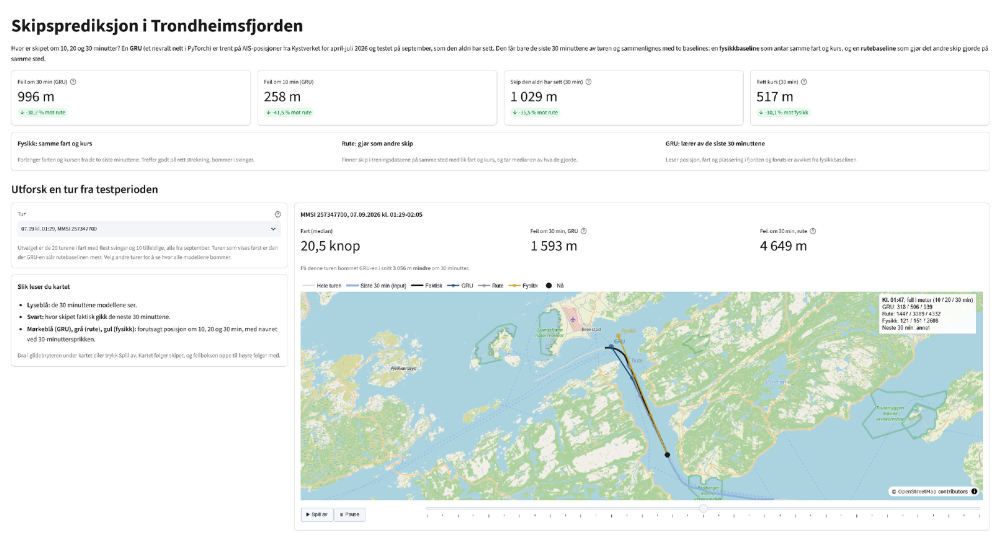

# Skipsprediksjon i Trondheimsfjorden

Forutsier hvor et skip er om 10, 20 og 30 minutter ut fra Kystverkets åpne AIS-data. En GRU i PyTorch sammenlignes med to baselines: en fysikkbaseline (skipet holder samme fart og kurs) og en rutebaseline (skipet gjør det andre skip gjorde på samme sted, med lik fart og kurs).



## Kort oppsummert

- Om 30 minutter bommer GRU-en med 996 m i snitt, **30 % mindre enn rutebaselinen** og 71 % mindre enn fysikkbaselinen.
- Den slår fysikken også når skipet går rett frem (517 mot 575 m), der fysikken er sterkest, og rutebaselinen i svinger (1503 mot 1733 m).
- På skip den aldri har sett i trening er feilen nesten den samme (1029 mot 989 m), så modellen har lært fjorden og ikke enkeltskip.
- Testet på september, en måned modellen aldri har sett, med 95 % konfidensintervall der hele turer trekkes om igjen (bootstrap).

## Resultater

Gjennomsnittlig feil i meter på september, med 95 % konfidensintervall:

| | 10 min | 20 min | 30 min |
| --- | --- | --- | --- |
| Fysikk | 625 (593–657) | 1830 (1746–1913) | 3449 (3299–3601) |
| Rute | 441 (419–465) | 905 (858–956) | 1427 (1351–1509) |
| **GRU** | **258 (242–274)** | **584 (545–625)** | **996 (931–1064)** |

Fordelt på hva skipet gjør de neste 30 minuttene (feil på 30 min):

| Situasjon | Andel | Fysikk | Rute | GRU |
| --- | --- | --- | --- | --- |
| Rett kurs | 29 % | 575 | 1148 | 517 |
| Sving | 33 % | 7322 | 1733 | 1503 |
| Fartsendring | 3 % | 3892 | 2234 | 2124 |
| Lav fart (under 2 knop) | 7 % | 2734 | 2174 | 1278 |
| Skip modellen aldri har sett | 17 % | 3566 | 1596 | 1029 |

Fysikkbaselinen faller sammen så snart skipet svinger, mens GRU-en og rutebaselinen har lært hvor leia går. Hele tabellen, med konfidensintervaller for hver gruppe, ligger i [`results/results.md`](results/results.md).

## Demo

`app/streamlit_app.py` viser 30 september-turer på kart: de siste 30 minuttene modellen ser, hva skipet faktisk gjorde og hvor fysikk, rute og GRU trodde det skulle være om 10, 20 og 30 minutter. Med glidebryteren kan man følge prediksjonene gjennom hele turen. Turene er valgt blant dem med en medianfart på minst 5 knop: de 20 med flest svinger, der modellene skiller seg mest, og 10 tilfeldige.

```powershell
pip install -e ".[app]"
ais-demo-data                        # lager app/data/ fra data/trips.parquet og models/gru.pt
streamlit run app/streamlit_app.py
```

Appen leser bare de små filene i `app/data/` og tallene i `results/results.json` (fra `ais-evaluate`), så den kan publiseres på Streamlit Community Cloud uten PyTorch og uten rådataene (`requirements.txt` er appens avhengigheter). Oppsettet og fargene er de samme som i [bussprosjektet](https://github.com/jeghetermats/bussforsinkelser-trondheim).

## Metode

**Data.** Historiske AIS-posisjoner fra [Kystverket](https://hais.kystverket.no/) for april–september 2026, innenfor `POLYGON((9.5 63.25, 11.6 63.25, 11.6 64.1, 9.5 64.1, 9.5 63.25))`. Kilde: Kystverket, lisensiert under [NLOD](https://data.norge.no/nlod/no/2.0). Fiskefartøy under 15 m og fritidsbåter under 45 m er ikke med. Skip i fart sender posisjon omtrent hvert 6. sekund (median i september).

**Rensing (`ais-prepare`).** Fjerner duplikater, ugyldige verdier, punkter der skipet ligger stille og posisjonshopp som tilsvarer over 50 knop. Deler sporene i turer der det er hull på over 5 minutter, og interpolerer hver tur til faste 1-minutters steg. Det gir 2 millioner minutter fordelt på 19 940 turer fra 1080 skip.

**Eksempler.** Hvert eksempel er de siste 30 minuttene av en tur, og målet er forflytningen 10, 20 og 30 minutter frem. Hvert eksempel får en situasjon ut fra hva skipet gjør de neste 30 minuttene: sving (kursendring på minst 30 grader), fartsendring, rett kurs eller annet. Skip under 2 knop får en egen kategori, «lav fart», fordi kursen da mest er støy i posisjonene.

**Oppdeling.** Trening på april–juli, valg av epoke på august og test på september. I tillegg holdes omtrent hvert femte skip helt utenfor trening og validering, slik at testen også måler hvordan modellen gjør det på skip den aldri har sett. Utvalget gjøres med en hash av MMSI-nummeret. Den første versjonen brukte `mmsi % 5`, men norske MMSI-nummer ender ofte på 0, så nesten alle skip ble holdt utenfor.

**Modell.** En GRU med to lag (128 enheter) leser posisjon, steg per minutt, fart og posisjon i fjorden for hvert av de 30 minuttene. Den forutsier avviket fra fysikkbaselinen i stedet for hele forflytningen, så rett kurs kommer gratis og kapasiteten går til svinger og fartsendringer. Tapsfunksjonen er gjennomsnittlig avstand i meter, det samme som evalueringen bruker. Treningen stopper når valideringsfeilen ikke har blitt bedre på 3 epoker, og den beste epoken beholdes.

**Kontroller av evalueringen.**
- *Er fysikkbaselinen for svak?* Den bruker farten fra de to siste minuttene. Fart beregnet over 3, 5 eller 10 minutter ga større feil (for eksempel 721 m i stedet for 625 m om 10 minutter med 5 minutter), så baselinen er den beste av sin type.
- *Lekker interpoleringen fra framtiden?* Posisjonen i ankerøyeblikket interpoleres mot neste AIS-melding, som kan ligge litt fram i tid. Medianavstanden mellom meldinger er 6 sekunder, og bare 0,3 % av hullene er over 1 minutt, så effekten er neglisjerbar.

## Begrensninger

- Bare én fjord og et halvt år. Vinter, uvær og andre farvann er ikke testet.
- Modellen vet ikke hvor skipet skal. Når et skip snur eller går inn til kai uten forvarsel, bommer alle modellene.
- Ved fartsendringer er GRU-en bare litt bedre enn rutebaselinen, og forskjellen er innenfor usikkerheten.
- Én treningskjøring. Konfidensintervallene dekker variasjonen i testdataene, ikke i treningen.

## Kjøring

```powershell
python -m venv .venv
.venv\Scripts\activate
pip install -e ".[dev]"
pip install torch --index-url https://download.pytorch.org/whl/cu128   # GPU; uten GPU: pip install torch

ais-prepare --raw data/raw --out data/trips.parquet   # Kystverket-filene pakkes ut i data/raw
ais-train                                             # lagrer models/gru.pt
ais-evaluate                                          # skriver results/results.md
```

Treningen tar noen minutter på et GTX 1660 Super.

## Utvikling

```bash
pytest -q
ruff check .
```

Testene dekker rensing, eksempler, situasjonsinndeling, begge baselines, utvalget av nye skip, konfidensintervallene og at GRU-en kan trenes. GitHub Actions kjører testene og kodesjekken ved hver endring (GRU-testen hoppes over der, siden PyTorch ikke installeres i CI).
